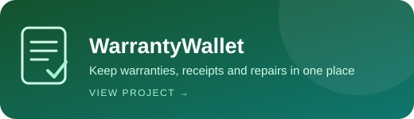
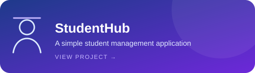

  <em>Curious developer • Lifelong learner • Problem solver</em>

---

### About

- Learning and building with **Python and backend technologies**
- Interested in **APIs, databases, and practical AI integration**
- Focused on writing clean code and improving every day

### Tech

  

### Featured projects

### GitHub activity

---

  Thanks for visiting — keep building. ✦

