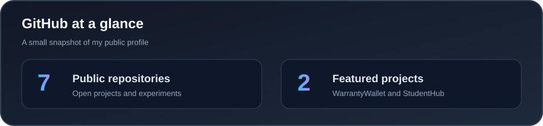
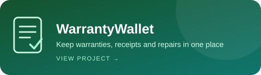
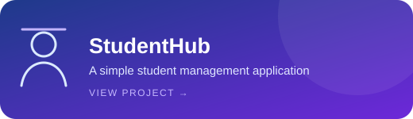

### ✨ A little space on the internet to share ideas and explore.

**Stay curious. Keep growing. Make every day count.**

 

### ⭐ Featured projects

### 🔗 Find me around GitHub

💙 **Thanks for stopping by. Have a wonderful day!**

